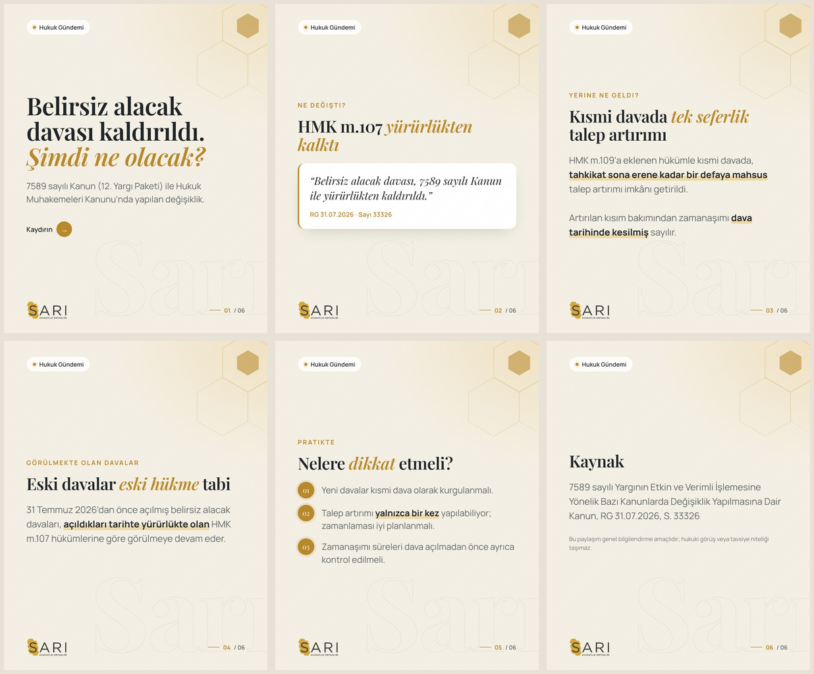
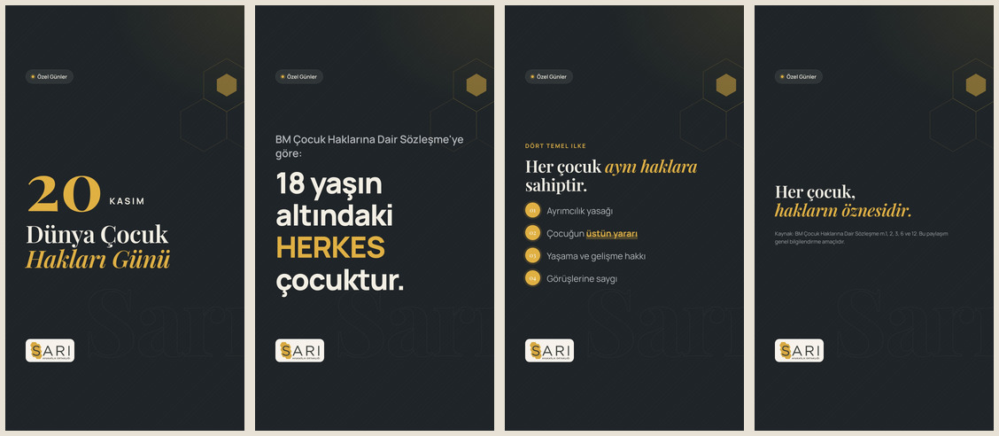

# Onay paketi: 16 Kasım Pazartesi – 22 Kasım Pazar

Onaylamak için sohbete gönderilerin tarihlerini yazmanız yeterli, örneğin **"16, 17 ve 18 Kasım'ı onaylıyorum"**. Düzeltme isterseniz tarihi ve değişikliği yazın. Onaylanan gönderiler planlanan gün sabah 09:50'de yayınlanır.

| # | Tarih | Seri | Format | Önizleme |
|---|---|---|---|---|
| 1 | 16 Kasım Pazartesi 10:00 | Hukuk Gündemi | Kaydırmalı | [önizleme](onay/01_2026-11-16_belirsiz-alacak.jpg) |
| 2 | 17 Kasım Salı 10:00 | Bu Senin Hakkın | Reels | [önizleme](onay/02_2026-11-17_repost-akran-zorbaligi.jpg) |
| 3 | 18 Kasım Çarşamba 10:00 | Hukuk Sözlüğü | Tek görsel | [önizleme](onay/03_2026-11-18_sozluk-tenfiz.jpg) |
| 4 | 19 Kasım Perşembe 10:00 | Alan Rehberi | Kaydırmalı | [önizleme](onay/04_2026-11-19_rehber-mirasin-reddi.jpg) |
| 5 | 20 Kasım Cuma 10:00 | Özel Günler | Reels | [önizleme](onay/05_2026-11-20_cocuk-haklari.jpg) |


## 1. 16 Kasım Pazartesi · Hukuk Gündemi · Kaydırmalı



**Açıklama metni:**

```
Belirsiz alacak davası artık yok. Peki alacağın miktarını baştan bilemeyenler ne yapacak? ⚖️

12. Yargı Paketi olarak bilinen 7589 sayılı Kanun ile HMK m.107 yürürlükten kaldırıldı. Yerine kısmi davada bir defaya mahsus talep artırımı imkânı getirildi.

📌 Değişiklik 31 Temmuz 2026'da yürürlüğe girdi.
📌 Bu tarihten önce açılan belirsiz alacak davaları eski hükme göre görülmeye devam ediyor.
📌 Talep artırımı yalnızca bir kez yapılabiliyor.

Ayrıntılar kaydırmalı görselde. Daha sonra dönüp bakmak için kaydedebilirsiniz.

Kaynak: 7589 s. Kanun, RG 31.07.2026, S. 33326
Bu paylaşım genel bilgilendirme amaçlıdır; hukuki görüş veya tavsiye niteliği taşımaz.

#hukuk #yargıpaketi #HMK #medeniusul #mevzuat
```

**Kontrol edilecekler:**

- [ ] İkincil kaynaklarla teyit edildi (aşağıdaki kaynaklar): HMK m.107 31.07.2026'da yürürlükten kalktı; m.109/4 tahkikat sonuna kadar bir defalık artırım ve zamanaşımının dava tarihinde kesilmesi. Resmî Gazete metnine bu ortamdan erişilemedi; avukat kontrolü önerilir.
- [ ] Faiz başlangıcı konusunda kanun sessiz; gönderide faizden söz edilmiyor.

**Durum:** ⏳ Onay bekliyor

---

## 2. 17 Kasım Salı · Bu Senin Hakkın · Reels


**Açıklama metni:**

```
Çocuğunuz okulda akran zorbalığına maruz kalıyorsa sessiz kalmak zorunda değilsiniz.

🎥 Videonun tamamı @buseninhakkin hesabında.

Bu paylaşım genel bilgilendirme amaçlıdır; hukuki görüş veya tavsiye niteliği taşımaz.

#BuSeninHakkın #SarıAvukatlıkOrtaklığı
```

**Kaynak gönderi:** https://www.instagram.com/reel/DfhIYbfIqPG/

**Kontrol edilecekler:**

- [ ] Kanca metni videonun içeriğiyle örtüşüyor mu?

**Durum:** ⏳ Onay bekliyor

---

## 3. 18 Kasım Çarşamba · Hukuk Sözlüğü · Tek görsel


**Açıklama metni:**

```
Hukuk Sözlüğü: Tenfiz 📖

Yurt dışında verilen bir boşanma, alacak veya ticari karar Türkiye'de kendiliğinden geçerli olmaz.

▫️ Tanıma: Yabancı kararın kesin hüküm ya da delil etkisinden yararlanmak için yeterlidir. Örneğin yurt dışında boşanan birinin nüfus kaydının güncellenmesi.
▫️ Tenfiz: Kararın Türkiye'de icra yoluyla zorla uygulanabilmesi için gereklidir. Örneğin yabancı mahkemenin hükmettiği bir alacağın tahsili.

Her iki süreç de 5718 sayılı Milletlerarası Özel Hukuk ve Usul Hukuku Hakkında Kanun'da (m.50–59) düzenlenir.

Bu paylaşım genel bilgilendirme amaçlıdır; hukuki görüş veya tavsiye niteliği taşımaz.

#hukuksözlüğü #tenfiz #tanıma #MÖHUK #yurtdışıboşanma
```

**Kontrol edilecekler:**

- [ ] İkincil kaynaklarla teyit edildi: tanıma ile ilam kesin hüküm/kesin delil etkisi kazanır, tenfiz icra edilebilirlik sağlar (MÖHUK m.50 vd., m.58). Avukat kontrolü önerilir.

**Durum:** ⏳ Onay bekliyor

---

## 4. 19 Kasım Perşembe · Alan Rehberi · Kaydırmalı


**Açıklama metni:**

```
Mirası reddetmek mümkün; ama süre kısa. ⏳

Türk Medeni Kanunu'na göre yasal ve atanmış mirasçılar mirası reddedebilir. Ret, borçlar dahil tüm mirastan vazgeçmek anlamına gelir.

📌 Süre: 3 ay (TMK m.606)
📌 Yer: Mirasbırakanın son yerleşim yerindeki sulh hukuk mahkemesi
📌 Şekil: Sözlü veya yazılı, kayıtsız ve şartsız beyan
📌 Borca batık terekede miras reddedilmiş sayılabilir (hükmen ret)

🎥 "Miras kaldı ama borç çıktı" konusunun videolu anlatımı @buseninhakkin hesabında.

Daha sonra dönüp bakmak için kaydedebilirsiniz.

Kaynak: TMK m.605, 606, 609
Bu paylaşım genel bilgilendirme amaçlıdır; hukuki görüş veya tavsiye niteliği taşımaz.

#mirashukuku #mirasınreddi #TMK #aile #miras
```

**Kontrol edilecekler:**

- [ ] İkincil kaynaklarla teyit edildi: TMK m.606 süre 3 ay; yasal mirasçılar için ölümü öğrenme tarihinden (mirasçı olduğunu sonradan öğrenen için o tarihten), atanmış mirasçılar için tasarrufun resmen bildirildiği tarihten başlar. Hükmen ret için 3 aylık süre uygulanmaz. Avukat kontrolü önerilir.

**Durum:** ⏳ Onay bekliyor

---

## 5. 20 Kasım Cuma · Özel Günler · Reels



**Açıklama metni:**

```
20 Kasım Dünya Çocuk Hakları Günü 🧒

BM Çocuk Haklarına Dair Sözleşme 20 Kasım 1989'da kabul edildi. Bugün dünyada en çok taraf olunan insan hakları sözleşmelerinden biri.

Sözleşmenin dört temel ilkesi:
1️⃣ Ayrımcılık yasağı
2️⃣ Çocuğun üstün yararı
3️⃣ Yaşama ve gelişme hakkı
4️⃣ Çocuğun görüşlerine saygı

Her çocuk, hakların öznesidir.

🎥 Okulda akran zorbalığı ve okulun sorumluluğu hakkındaki videomuz için: @buseninhakkin

Bu paylaşım genel bilgilendirme amaçlıdır.

#DünyaÇocukHaklarıGünü #20Kasım #çocukhakları #insanhakları
```

**Not:** Video sessiz bir ses kanalıyla üretildi. İsterseniz yayından sonra uygulamadan telifsiz müzik eklenebilir.

**Kontrol edilecekler:**

- [ ] Türkiye'de yürürlük yılı (1995) Resmî Gazete kaydından teyit edilmeli.

**Durum:** ⏳ Onay bekliyor

---
