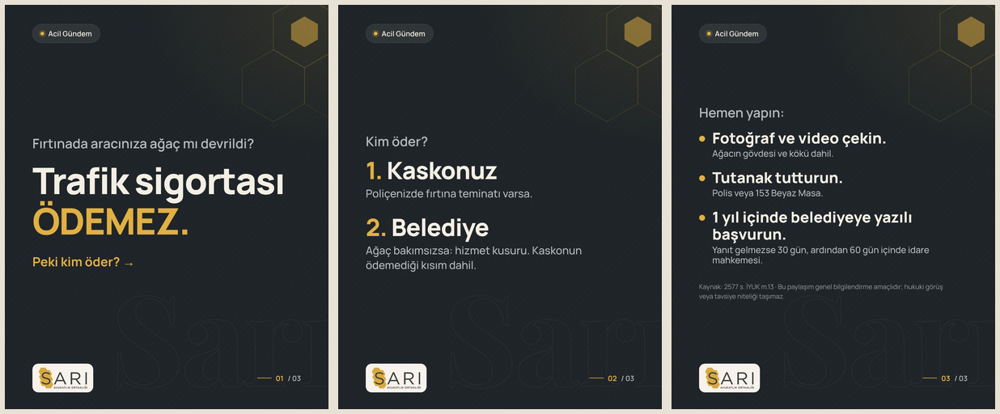
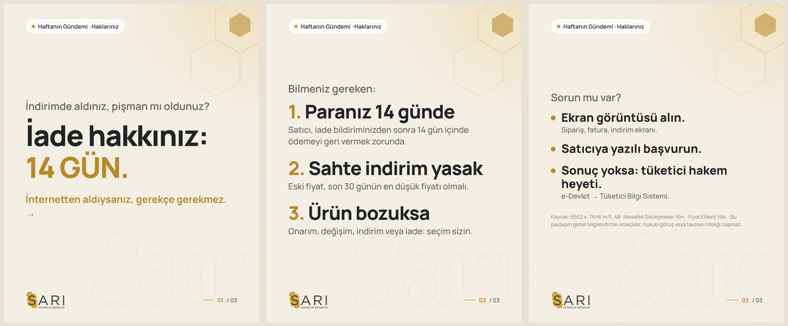
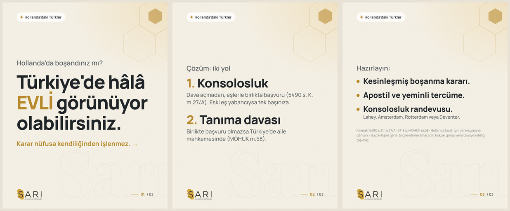
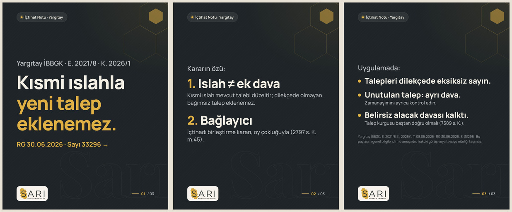
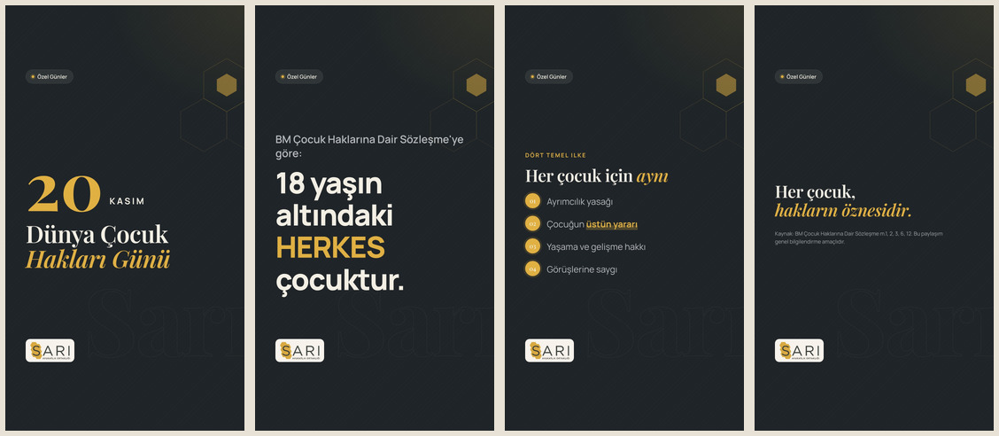

# Onay paketi: 15 Kasım Pazar – 22 Kasım Pazar

Onaylamak için sohbete gönderilerin tarihlerini yazmanız yeterli, örneğin **"16, 17 ve 18 Kasım'ı onaylıyorum"**. Düzeltme isterseniz tarihi ve değişikliği yazın. Onaylanan gönderiler planlanan gün sabah 09:50'de yayınlanır.

| # | Tarih | Seri | Format | Önizleme |
|---|---|---|---|---|
| 1 | 16 Kasım Pazartesi 10:00 | Acil Gündem | Kaydırmalı | [önizleme](onay/01_2026-11-15_acil-firtina-v2.jpg) |
| 2 | 16 Kasım Pazartesi 10:00 | Haftanın Gündemi · Haklarınız | Kaydırmalı | [önizleme](onay/02_2026-11-16_haklariniz-indirim-iade.jpg) |
| 3 | 17 Kasım Salı 10:00 | Bu Senin Hakkın | Reels | [önizleme](onay/03_2026-11-17_repost-akran-zorbaligi.jpg) |
| 4 | 18 Kasım Çarşamba 10:00 | Hollanda'daki Türkler | Kaydırmalı | [önizleme](onay/04_2026-11-18_hollanda-bosanma-tescil.jpg) |
| 5 | 19 Kasım Perşembe 10:00 | İçtihat Notu | Kaydırmalı | [önizleme](onay/05_2026-11-19_ictihat-kismi-islah.jpg) |
| 6 | 20 Kasım Cuma 10:00 | Özel Günler | Reels | [önizleme](onay/06_2026-11-20_cocuk-haklari.jpg) |


## 1. 16 Kasım Pazartesi · Acil Gündem · Kaydırmalı



**Açıklama metni:**

```
Fırtınada aracınıza ağaç devrildiyse: trafik sigortası ödemez. 🌳🚗

Kim öder?
1️⃣ Kaskonuz (fırtına teminatı varsa)
2️⃣ Belediye (ağaç bakımsızsa, hizmet kusuru)

📸 Fotoğraflayın, tutanak tutturun, 1 yıl içinde belediyeye yazılı başvurun.

İstanbul'da 18 Kasım'dan itibaren yeniden kuvvetli lodos bekleniyor. Aracını sokakta park eden birine gönderin.

Kaynak: 2577 s. İYUK m.13
Bu paylaşım genel bilgilendirme amaçlıdır; hukuki görüş veya tavsiye niteliği taşımaz.

#lodos #fırtına #kasko #haklarınız
```

**Not:** İlk sürümün (15.11.2026, 6 slayt) yerine sade ve vurucu 3 slaytlık yeni tasarım.

**Kontrol edilecekler:**

- [ ] İYUK m.13'teki 30 günlük yanıt süresi ve 1 yıl / 5 yıl süreleri kanun metninden teyit edilmeli.
- [ ] Standart kaskoda fırtına ve ağaç devrilmesinin ana teminat mı ek teminat mı olduğu poliçeye göre değişebilir; gönderi 'poliçenizi kontrol edin' diyor.

**Durum:** ⏳ Onay bekliyor

---

## 2. 16 Kasım Pazartesi · Haftanın Gündemi · Haklarınız · Kaydırmalı



**Açıklama metni:**

```
İndirimde aldığınız ürünü iade edebilirsiniz: internetten aldıysanız 14 gün içinde, gerekçe göstermeden. 🛍️

💸 Paranız 14 günde iade edilmeli.
🏷️ Eski fiyat = son 30 günün en düşük fiyatı.
🔧 Ürün bozuksa onarım, değişim, indirim veya iade.

Alışverişe çıkmadan kaydedin.

Kaynak: 6502 s. TKHK m.11, 48 · Mesafeli Sözleşmeler Yönetmeliği · Fiyat Etiketi Yönetmeliği
Bu paylaşım genel bilgilendirme amaçlıdır; hukuki görüş veya tavsiye niteliği taşımaz.

#tüketicihakları #caymahakkı #indirim #iade
```

**Not:** 15.11.2026 revizyonu: kısa ve vurucu dil, 3–4 slayt.

**Kontrol edilecekler:**

- [ ] 30 gün kuralı raf ve fiyat etiketleri için geçerli; reklamlarda Bakanlık kılavuzuyla farklı (10 günlük) bir pencere uygulanıyor olabilir. Gönderi etiket fiyatı üzerinden anlatıyor.
- [ ] Cayma hakkı istisnaları (Mesafeli Sözleşmeler Yön. m.15) açıklamada genel olarak sayıldı.

**Durum:** ⏳ Onay bekliyor

---

## 3. 17 Kasım Salı · Bu Senin Hakkın · Reels


**Açıklama metni:**

```
Çocuğunuz okulda akran zorbalığına maruz kalıyorsa sessiz kalmak zorunda değilsiniz.

🎥 Videonun tamamı @buseninhakkin hesabında.

Bu paylaşım genel bilgilendirme amaçlıdır; hukuki görüş veya tavsiye niteliği taşımaz.

#BuSeninHakkın #SarıAvukatlıkOrtaklığı
```

**Kaynak gönderi:** https://www.instagram.com/reel/DfhIYbfIqPG/

**Kontrol edilecekler:**

- [ ] Kanca metni videonun içeriğiyle örtüşüyor mu?

**Durum:** ✅ Onaylandı

---

## 4. 18 Kasım Çarşamba · Hollanda'daki Türkler · Kaydırmalı



**Açıklama metni:**

```
Hollanda'da boşandınız ama Türkiye'de hâlâ evli görünüyor olabilirsiniz. 🇳🇱🇹🇷

Karar nüfusa kendiliğinden işlenmez. İki yol var:
1️⃣ Konsolosluk: dava açmadan, eşlerle birlikte başvuru (eski eş yabancıysa tek başınıza).
2️⃣ Tanıma davası: Türkiye'de aile mahkemesinde.

İhtiyacı olan birine gönderin.

🇳🇱 Een Nederlandse echtscheiding wordt niet automatisch in het Turkse register verwerkt. Registratie kan zonder rechtszaak via het Turkse consulaat, anders via een erkenningsprocedure bij de Turkse familierechtbank.

Kaynak: 5490 s. K. m.27/A · 5718 s. MÖHUK m.58
Bu paylaşım genel bilgilendirme amaçlıdır; hukuki görüş veya tavsiye niteliği taşımaz.

#HollandadakiTürkler #boşanma #konsolosluk #nüfus
```

**Not:** 15.11.2026 revizyonu: kısa ve vurucu dil, 3–4 slayt.

**Kontrol edilecekler:**

- [ ] m.27/A başvurusunda konsoloslukların istediği belge listesi (apostil ve tercüme şekli) Lahey Büyükelçiliği uygulamasıyla teyit edilmeli.
- [ ] Felemenkçe özet bir Felemenkçe bilen tarafından okunmalı.

**Durum:** ⏳ Onay bekliyor

---

## 5. 19 Kasım Perşembe · İçtihat Notu · Kaydırmalı



**Açıklama metni:**

```
İçtihat Notu | Kısmi ıslahla yeni talep eklenemez.

Yargıtay İçtihatları Birleştirme Büyük Genel Kurulu, E. 2021/8, K. 2026/1, T. 08.05.2026 (RG 30.06.2026, S. 33296).

▪️ Kısmi ıslah mevcut talebi düzeltir; dava dilekçesinde olmayan bağımsız talep bu yolla eklenemez.
▪️ Talepler dilekçede eksiksiz sayılmalı; unutulan talep için ayrı dava ve zamanaşımı kontrolü gerekir.

Bu paylaşım genel bilgilendirme amaçlıdır; hukuki görüş veya tavsiye niteliği taşımaz.

#Yargıtay #içtihadıbirleştirme #ıslah #HMK
```

**Not:** 15.11.2026 revizyonu: kısa ve vurucu dil, 3–4 slayt.

**Kontrol edilecekler:**

- [ ] Gerekçe özeti ikincil kaynaklara dayanıyor; karar metniyle karşılaştırılmalı.
- [ ] Bağlayıcılık için 2797 s. Kanun m.45 atfının fıkrası teyit edilmeli.

**Durum:** ⏳ Onay bekliyor

---

## 6. 20 Kasım Cuma · Özel Günler · Reels



**Açıklama metni:**

```
20 Kasım Dünya Çocuk Hakları Günü 🧒

18 yaşın altındaki herkes çocuktur ve dört temel ilkeyle korunur: ayrımcılık yasağı, çocuğun üstün yararı, yaşama ve gelişme hakkı, görüşlerine saygı.

Her çocuk, hakların öznesidir.

Kaynak: BM Çocuk Haklarına Dair Sözleşme
#DünyaÇocukHaklarıGünü #20Kasım #çocukhakları
```

**Not:** 15.11.2026 revizyonu: kısa ve vurucu dil, 3–4 slayt.

**Kontrol edilecekler:**

- [ ] Türkiye'de yürürlük yılı (1995) Resmî Gazete kaydından teyit edilmeli.

**Durum:** ⏳ Onay bekliyor

---
