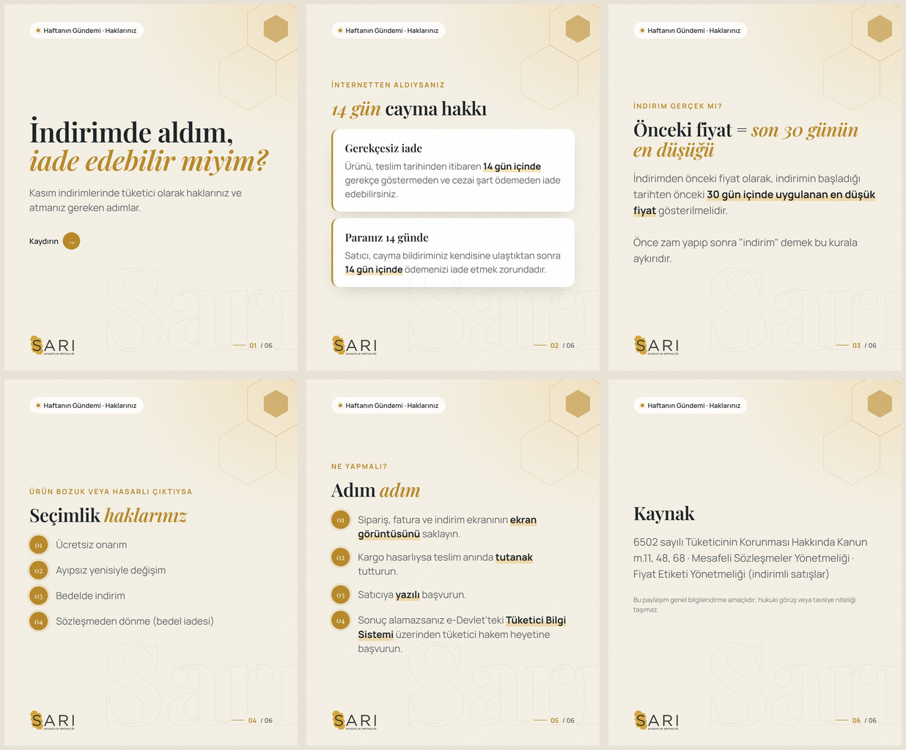
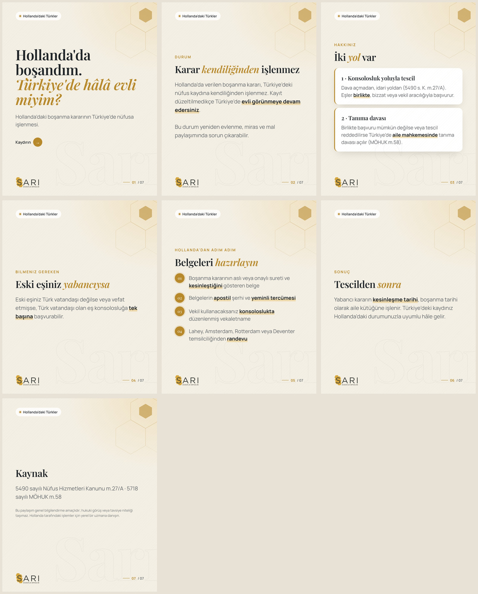

# Onay paketi: 16 Kasım Pazartesi – 22 Kasım Pazar

Onaylamak için sohbete gönderilerin tarihlerini yazmanız yeterli, örneğin **"16, 17 ve 18 Kasım'ı onaylıyorum"**. Düzeltme isterseniz tarihi ve değişikliği yazın. Onaylanan gönderiler planlanan gün sabah 09:50'de yayınlanır.

| # | Tarih | Seri | Format | Önizleme |
|---|---|---|---|---|
| 1 | 16 Kasım Pazartesi 10:00 | Haftanın Gündemi · Haklarınız | Kaydırmalı | [önizleme](onay/01_2026-11-16_haklariniz-indirim-iade.jpg) |
| 2 | 17 Kasım Salı 10:00 | Bu Senin Hakkın | Reels | [önizleme](onay/02_2026-11-17_repost-akran-zorbaligi.jpg) |
| 3 | 18 Kasım Çarşamba 10:00 | Hollanda'daki Türkler | Kaydırmalı | [önizleme](onay/03_2026-11-18_hollanda-bosanma-tescil.jpg) |
| 4 | 19 Kasım Perşembe 10:00 | İçtihat Notu | Kaydırmalı | [önizleme](onay/04_2026-11-19_ictihat-kismi-islah.jpg) |
| 5 | 20 Kasım Cuma 10:00 | Özel Günler | Reels | [önizleme](onay/05_2026-11-20_cocuk-haklari.jpg) |


## 1. 16 Kasım Pazartesi · Haftanın Gündemi · Haklarınız · Kaydırmalı



**Açıklama metni:**

```
İndirimde aldığınız ürünü iade edebilir misiniz? Evet, çoğu durumda. 🛍️

Kasım indirimlerinde en çok sorulan sorulara kısa yanıtlar:

📦 İnternetten aldıysanız: teslimden itibaren 14 gün içinde gerekçe göstermeden cayma hakkınız var. Satıcı, bildiriminiz ulaştıktan sonra 14 gün içinde paranızı iade etmek zorunda.
🏷️ İndirim gerçek olmalı: önceki fiyat, indirimden önceki 30 gün içindeki en düşük fiyattır.
🔧 Ürün ayıplıysa: onarım, değişim, bedelde indirim veya iade arasında seçim yapabilirsiniz.

⚠️ Cayma hakkının istisnaları var: kişiye özel üretilen ürünler, çabuk bozulan ürünler ve ambalajı açılmış hijyen ürünleri gibi.

Kaydedin; alışverişten önce bir kez daha bakın.

Kaynak: 6502 s. TKHK m.11, 48, 68 · Mesafeli Sözleşmeler Yönetmeliği · Fiyat Etiketi Yönetmeliği
Bu paylaşım genel bilgilendirme amaçlıdır; hukuki görüş veya tavsiye niteliği taşımaz.

#tüketicihakları #caymahakkı #indirim #iade #haklarınız
```

**Kontrol edilecekler:**

- [ ] 30 gün kuralı raf ve fiyat etiketleri için geçerli; reklamlarda Bakanlık kılavuzuyla farklı (10 günlük) bir pencere uygulanıyor olabilir. Gönderi etiket fiyatı üzerinden anlatıyor.
- [ ] Cayma hakkı istisnaları (Mesafeli Sözleşmeler Yön. m.15) açıklamada genel olarak sayıldı.

**Durum:** ✅ Onaylandı

---

## 2. 17 Kasım Salı · Bu Senin Hakkın · Reels


**Açıklama metni:**

```
Çocuğunuz okulda akran zorbalığına maruz kalıyorsa sessiz kalmak zorunda değilsiniz.

🎥 Videonun tamamı @buseninhakkin hesabında.

Bu paylaşım genel bilgilendirme amaçlıdır; hukuki görüş veya tavsiye niteliği taşımaz.

#BuSeninHakkın #SarıAvukatlıkOrtaklığı
```

**Kaynak gönderi:** https://www.instagram.com/reel/DfhIYbfIqPG/

**Kontrol edilecekler:**

- [ ] Kanca metni videonun içeriğiyle örtüşüyor mu?

**Durum:** ✅ Onaylandı

---

## 3. 18 Kasım Çarşamba · Hollanda'daki Türkler · Kaydırmalı



**Açıklama metni:**

```
Hollanda'da boşandınız ama Türkiye'de hâlâ evli mi görünüyorsunuz? 🇳🇱🇹🇷

Hollanda'da verilen boşanma kararı, Türkiye'deki nüfus kaydına kendiliğinden işlenmez. Bunun iki yolu var:

1️⃣ Konsolosluk veya nüfus müdürlüğü üzerinden, dava açmadan tescil (5490 s. K. m.27/A). Eşler birlikte, bizzat ya da vekil aracılığıyla başvurur. Eski eş yabancıysa veya vefat etmişse Türk vatandaşı eş tek başına başvurabilir.
2️⃣ Birlikte başvuru mümkün değilse, Türkiye'de aile mahkemesinde tanıma davası (MÖHUK m.58).

📄 Hazırlanacaklar: kesinleşmiş boşanma kararı, apostil, yeminli tercüme, gerekirse konsoloslukta düzenlenmiş vekaletname.

Bu bilgiye ihtiyacı olabilecek biriyle paylaşın.

🇳🇱 Samenvatting: Een echtscheiding die in Nederland is uitgesproken, wordt niet automatisch in het Turkse bevolkingsregister verwerkt. Dit kan zonder rechtszaak via het Turkse consulaat (art. 27/A Wet Bevolkingsdiensten). Lukt dat niet, dan volgt een erkenningsprocedure bij de Turkse familierechtbank.

Kaynak: 5490 s. Nüfus Hizmetleri K. m.27/A · 5718 s. MÖHUK m.58
Bu paylaşım genel bilgilendirme amaçlıdır; hukuki görüş veya tavsiye niteliği taşımaz. Hollanda tarafındaki işlemler için yerel bir uzmana danışın.

#HollandadakiTürkler #boşanma #tanıma #nüfus #konsolosluk
```

**Kontrol edilecekler:**

- [ ] m.27/A başvurusunda konsoloslukların istediği belge listesi (apostil ve tercüme şekli) Lahey Büyükelçiliği uygulamasıyla teyit edilmeli.
- [ ] Felemenkçe özet bir Felemenkçe bilen tarafından okunmalı.

**Durum:** ✅ Onaylandı

---

## 4. 19 Kasım Perşembe · İçtihat Notu · Kaydırmalı


**Açıklama metni:**

```
İçtihat Notu | Kısmi ıslahla, dava dilekçesinde yer almayan yeni bir talep eklenemez.

Yargıtay İçtihatları Birleştirme Büyük Genel Kurulu kararı.

Künye: E. 2021/8, K. 2026/1, T. 08.05.2026 (RG 30.06.2026, S. 33296)

Yüksek Mahkeme, daireler arasındaki görüş ayrılığını oy çokluğuyla gidermiştir. Gerekçede, kısmi ıslahın mevcut talep üzerinde düzeltme imkânı tanıdığı; dilekçede hiç bulunmayan bir istemin bu yolla eklenmesinin ıslahı fiilen ikinci bir dava açma aracına dönüştüreceği vurgulanmaktadır.

Uygulama açısından:
▪️ Talepler dava dilekçesinde eksiksiz belirtilmelidir.
▪️ Dilekçede yer almayan bağımsız talepler için ayrı dava ve zamanaşımı denetimi gerekir.
▪️ 7589 s. Kanun ile belirsiz alacak davasının kaldırılmasıyla birlikte talebin baştan doğru kurgulanması daha da önem kazanmıştır.

Bu paylaşım genel bilgilendirme amaçlıdır; hukuki görüş veya tavsiye niteliği taşımaz.

#Yargıtay #içtihadıbirleştirme #ıslah #HMK #medeniusulhukuku
```

**Kontrol edilecekler:**

- [ ] Gerekçe özeti ikincil kaynaklara dayanıyor; karar metniyle karşılaştırılmalı.
- [ ] Bağlayıcılık için 2797 s. Kanun m.45 atfının fıkrası teyit edilmeli.

**Durum:** ✅ Onaylandı

---

## 5. 20 Kasım Cuma · Özel Günler · Reels


**Açıklama metni:**

```
20 Kasım Dünya Çocuk Hakları Günü 🧒

BM Çocuk Haklarına Dair Sözleşme 20 Kasım 1989'da kabul edildi. Bugün dünyada en çok taraf olunan insan hakları sözleşmelerinden biri.

Sözleşmenin dört temel ilkesi:
1️⃣ Ayrımcılık yasağı
2️⃣ Çocuğun üstün yararı
3️⃣ Yaşama ve gelişme hakkı
4️⃣ Çocuğun görüşlerine saygı

Her çocuk, hakların öznesidir.

Bu paylaşım genel bilgilendirme amaçlıdır.

#DünyaÇocukHaklarıGünü #20Kasım #çocukhakları #insanhakları
```

**Not:** Video sessiz bir ses kanalıyla üretildi. İsterseniz yayından sonra uygulamadan telifsiz müzik eklenebilir.

**Kontrol edilecekler:**

- [ ] Türkiye'de yürürlük yılı (1995) Resmî Gazete kaydından teyit edilmeli.

**Durum:** ✅ Onaylandı

---
