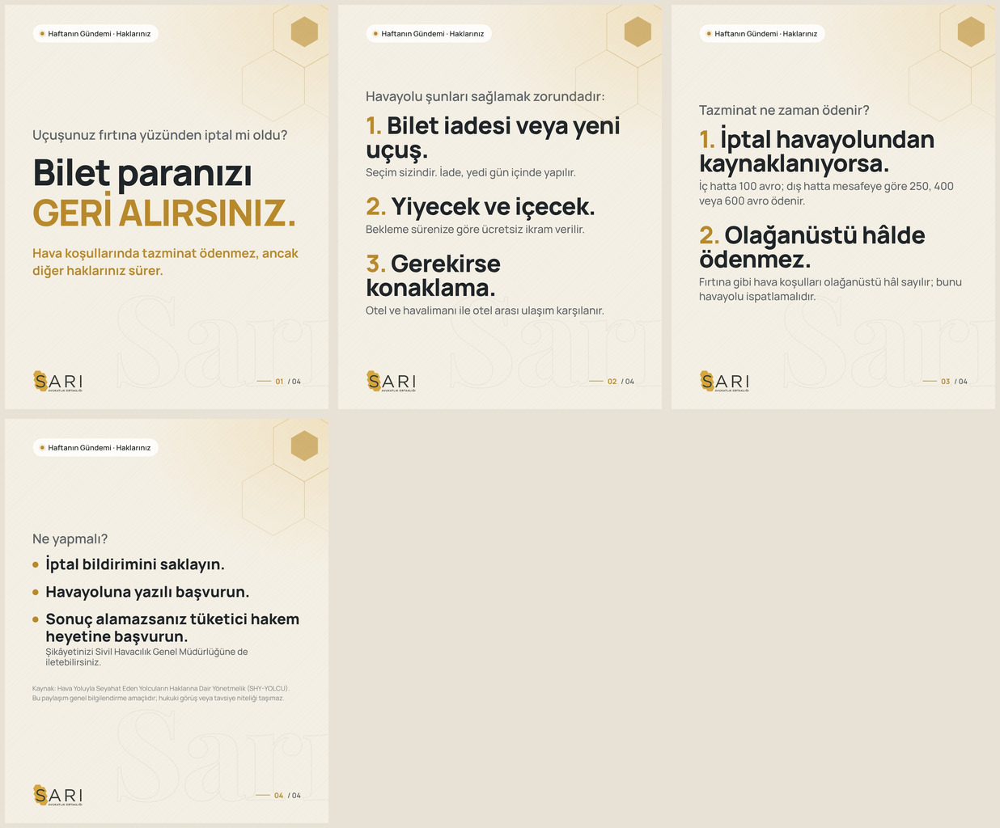
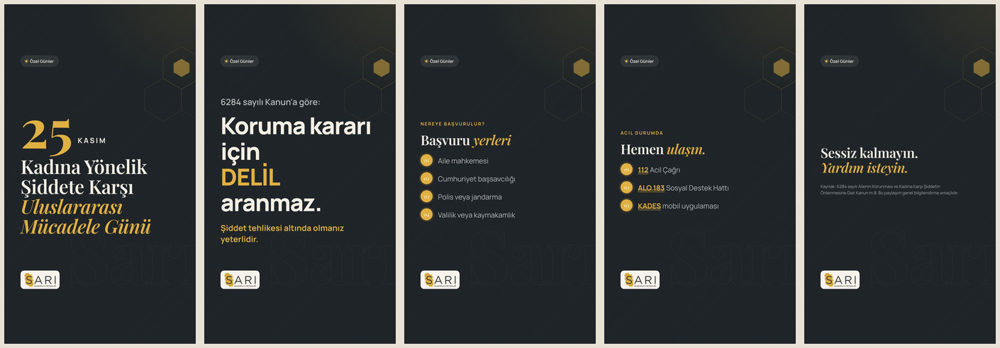
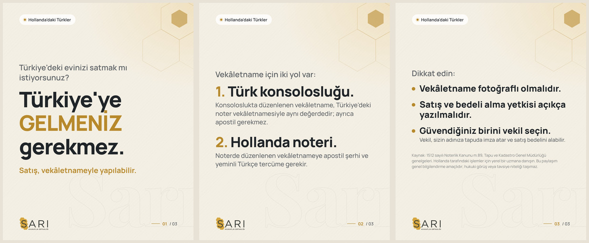
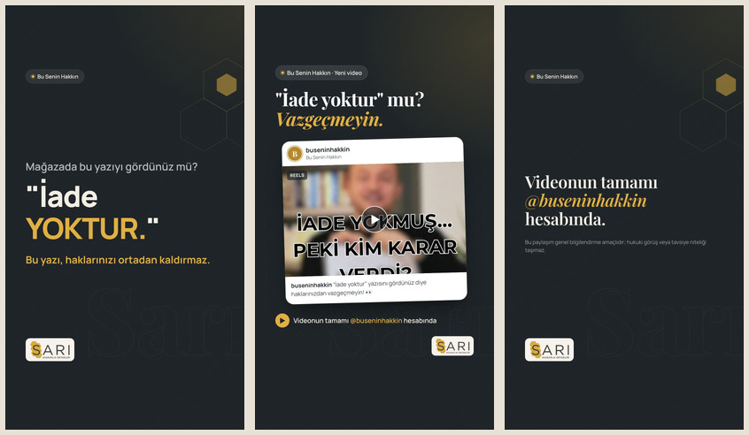
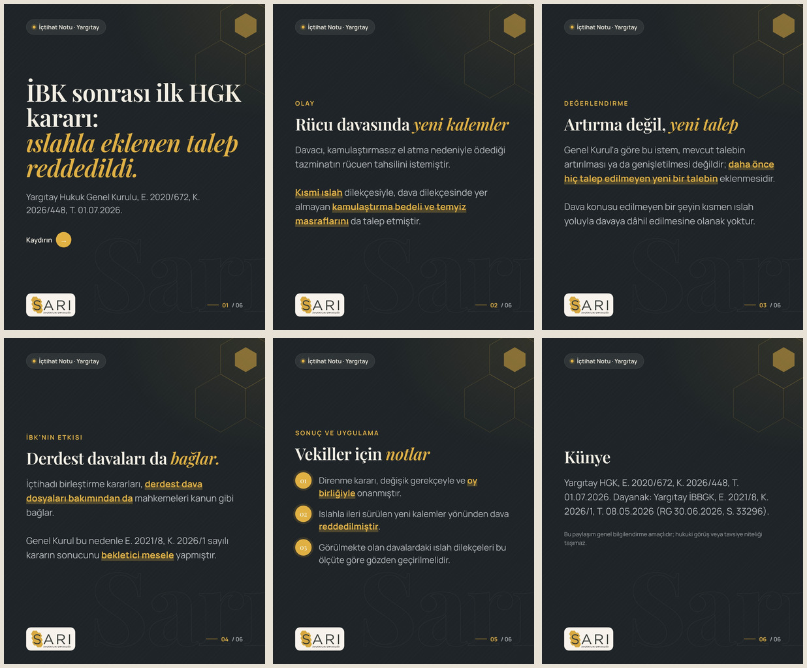
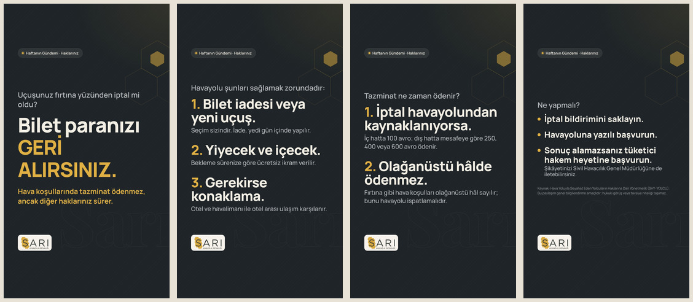

# Onay paketi: 23 Kasım Pazartesi – 29 Kasım Pazar

Onaylamak için sohbete gönderilerin tarihlerini yazmanız yeterli, örneğin **"16, 17 ve 18 Kasım'ı onaylıyorum"**. Düzeltme isterseniz tarihi ve değişikliği yazın. Onaylanan gönderiler planlanan gün sabah 09:50'de yayınlanır.

| # | Tarih | Seri | Format | Önizleme |
|---|---|---|---|---|
| 1 | 23 Kasım Pazartesi 10:00 | Haftanın Gündemi · Haklarınız | Kaydırmalı | [önizleme](onay/01_2026-11-23_haklariniz-ucus-iptali.jpg) |
| 2 | 24 Kasım Salı 09:30 | Özel Günler | Tek görsel | [önizleme](onay/02_2026-11-24_ogretmenler-gunu.jpg) |
| 3 | 25 Kasım Çarşamba 10:00 | Özel Günler | Reels | [önizleme](onay/03_2026-11-25_kadina-siddet.jpg) |
| 4 | 26 Kasım Perşembe 10:00 | Hollanda'daki Türkler | Kaydırmalı | [önizleme](onay/04_2026-11-26_hollanda-ev-satisi.jpg) |
| 5 | 27 Kasım Cuma 10:00 | Bu Senin Hakkın | Reels | [önizleme](onay/05_2026-11-27_repost-iade-yoktur.jpg) |
| 6 | 28 Kasım Cumartesi 10:00 | İçtihat Notu | Kaydırmalı | [önizleme](onay/06_2026-11-28_ictihat-ibk-ilk-uygulama.jpg) |
| 7 | 29 Kasım Pazar 10:00 | Haftanın Gündemi · Haklarınız | Reels | [önizleme](onay/07_2026-11-29_reels-ucus-iptali.jpg) |


## 1. 23 Kasım Pazartesi · Haftanın Gündemi · Haklarınız · Kaydırmalı



**Açıklama metni:**

```
Uçuşunuz fırtına yüzünden iptal edildiyse bilet paranızı geri alabilirsiniz. ✈️

Havayolu size şunları sağlamak zorundadır:
1️⃣ Bilet iadesi veya yeni uçuş. Seçim sizindir.
2️⃣ Bekleme sürenize göre yiyecek ve içecek.
3️⃣ Gerekirse konaklama ve ulaşım.

Fırtına gibi olağanüstü hâllerde ayrıca tazminat ödenmez. İptal havayolundan kaynaklanıyorsa iç hatta 100 avro, dış hatta mesafeye göre 250, 400 veya 600 avro tazminat ödenir.

Yakında uçacak birine gönderin.

Kaynak: Hava Yoluyla Seyahat Eden Yolcuların Haklarına Dair Yönetmelik (SHY-YOLCU).
Bu paylaşım genel bilgilendirme amaçlıdır; hukuki görüş veya tavsiye niteliği taşımaz.

#yolcuhakları #uçuşiptali #tüketicihakları #haklarınız
```

**Kontrol edilecekler:**

- [ ] Tazminat tutarları (100 / 250 / 400 / 600 avro) ve yedi günlük iade süresi ikincil kaynaklardan alındı; SHY-YOLCU metninden teyit edilmeli. Büroda UltraLaw açık olmadığı için yönetmelik metni açılamadı.
- [ ] İptal en az 14 gün önce bildirilmişse tazminat doğmaz; gönderide bu ayrıntı yer almıyor.

**Durum:** ✅ Onaylandı

---

## 2. 24 Kasım Salı · Özel Günler · Tek görsel


**Açıklama metni:**

```
Hakkı, adaleti ve sorumluluğu bize ilk kez sınıfta anlattılar. 📚

Başta Başöğretmenimiz Mustafa Kemal Atatürk olmak üzere tüm öğretmenlerimizin 24 Kasım Öğretmenler Günü'nü saygıyla kutlarız.

#24KasımÖğretmenlerGünü #ÖğretmenlerGünü
```

**Kontrol edilecekler:**

- [ ] Genel kontrol

**Durum:** ✅ Onaylandı

---

## 3. 25 Kasım Çarşamba · Özel Günler · Reels



**Açıklama metni:**

```
25 Kasım, Kadına Yönelik Şiddete Karşı Uluslararası Mücadele Günü. 🟣

6284 sayılı Kanun'a göre, koruyucu tedbir kararı verilmesi için şiddetin uygulandığına dair delil veya belge aranmaz.

📍 Başvuru: aile mahkemesi, Cumhuriyet başsavcılığı, polis veya jandarma, valilik veya kaymakamlık.
📞 Acil durumda: 112, ALO 183 ve KADES uygulaması.

Bu bilgiye ihtiyacı olabilecek biriyle paylaşın.

Kaynak: 6284 sayılı Kanun m.8.
Bu paylaşım genel bilgilendirme amaçlıdır; hukuki görüş veya tavsiye niteliği taşımaz.

#25Kasım #KadınaŞiddeteHayır #6284 #KADES
```

**Kontrol edilecekler:**

- [ ] 6284 s. K. m.8/3 ifadesi ikincil kaynaklarla uyumlu; büroda UltraLaw açık olmadığı için madde metni açılamadı.
- [ ] Acil hat numaralarının güncelliği (ALO 183, KADES) kontrol edilmeli.

**Durum:** ✅ Onaylandı

---

## 4. 26 Kasım Perşembe · Hollanda'daki Türkler · Kaydırmalı



**Açıklama metni:**

```
Türkiye'deki evinizi satmak için Türkiye'ye gelmeniz gerekmez. 🇳🇱🇹🇷

Satış, vekâletnameyle yapılabilir. Vekâletname için iki yol vardır:
1️⃣ Türk konsolosluğu: Burada düzenlenen vekâletname, Türkiye'deki noter vekâletnamesiyle aynı değerdedir.
2️⃣ Hollanda noteri: Vekâletnameye apostil şerhi ve yeminli Türkçe tercüme gerekir.

Vekâletname fotoğraflı olmalı; satış ve bedeli alma yetkisi açıkça yazılmalıdır.

Türkiye'de evi olan bir yakınınıza gönderin.

🇳🇱 Uw woning in Turkije verkopen kan zonder zelf naar Turkije te reizen. U geeft een volmacht af bij het Turkse consulaat, of bij een Nederlandse notaris met apostille en beëdigde vertaling. De volmacht moet een pasfoto bevatten en de verkoopbevoegdheid uitdrukkelijk vermelden.

Kaynak: 1512 sayılı Noterlik Kanunu m.89, Tapu ve Kadastro Genel Müdürlüğü genelgeleri.
Bu paylaşım genel bilgilendirme amaçlıdır; hukuki görüş veya tavsiye niteliği taşımaz. Hollanda tarafındaki işlemler için yerel bir uzmana danışın.

#HollandadakiTürkler #tapu #vekâletname #konsolosluk
```

**Kontrol edilecekler:**

- [ ] Noterlik Kanunu m.89 atfı (tapu işlemlerine ilişkin vekâletnamelerin düzenleme şeklinde yapılması) kanun metninden teyit edilmeli; büroda UltraLaw açık olmadığı için madde açılamadı.
- [ ] Fotoğraf zorunluluğu TKGM genelgesine dayanıyor; güncel genelge sayısı teyit edilmeli.
- [ ] Felemenkçe özet bir Felemenkçe bilen tarafından okunmalı.

**Durum:** ✅ Onaylandı

---

## 5. 27 Kasım Cuma · Bu Senin Hakkın · Reels



**Açıklama metni:**

```
“İade yoktur” yazısını gördünüz diye haklarınızdan vazgeçmeyin! 👀

🎥 Videonun tamamı @buseninhakkin hesabında.

Bu paylaşım genel bilgilendirme amaçlıdır; hukuki görüş veya tavsiye niteliği taşımaz.

#BuSeninHakkın #SarıAvukatlıkOrtaklığı
```

**Kaynak gönderi:** https://www.instagram.com/reel/DfzC2iEIhPr/

**Kontrol edilecekler:**

- [ ] Kanca metni videonun içeriğiyle örtüşüyor mu?

**Durum:** ✅ Onaylandı

---

## 6. 28 Kasım Cumartesi · İçtihat Notu · Kaydırmalı



**Açıklama metni:**

```
İçtihat Notu | İçtihadı birleştirme kararından sonraki ilk Hukuk Genel Kurulu kararı.

Yargıtay Hukuk Genel Kurulu, E. 2020/672, K. 2026/448, T. 01.07.2026.

Rücuen tazminat davasında davacı, kısmi ıslah dilekçesiyle dava dilekçesinde yer almayan kamulaştırma bedelini ve temyiz masraflarını da talep etmiştir. Genel Kurul, bu istemin mevcut talebin artırılması değil, daha önce hiç talep edilmeyen yeni bir talebin eklenmesi olduğunu; dava konusu edilmeyen bir şeyin kısmen ıslah yoluyla davaya dâhil edilemeyeceğini belirtmiştir.

Kararda ayrıca, içtihadı birleştirme kararlarının derdest dava dosyaları bakımından da mahkemeleri bağladığı vurgulanmış; E. 2021/8, K. 2026/1 sayılı kararın sonucu bekletici mesele yapılmıştır. Direnme kararı, değişik gerekçeyle ve oy birliğiyle onanmıştır.

Uygulama açısından, görülmekte olan davalardaki ıslah dilekçelerinin bu ölçüte göre gözden geçirilmesi yerinde olacaktır.

Bu paylaşım genel bilgilendirme amaçlıdır; hukuki görüş veya tavsiye niteliği taşımaz.

#Yargıtay #HukukGenelKurulu #ıslah #HMK #medeniusulhukuku
```

**Kontrol edilecekler:**

- [ ] Künye, olay, gerekçe (26–27. paragraflar), bağlayıcılık (22–23. paragraflar) ve hüküm UltraLaw deposunda karar metninden doğrulandı (22.11.2026).
- [ ] Son uygulama notu büronun değerlendirmesidir; kararda geçmez.

**Durum:** ✅ Onaylandı

---

## 7. 29 Kasım Pazar · Haftanın Gündemi · Haklarınız · Reels



**Açıklama metni:**

```
Uçuşunuz iptal mi oldu? Bilet paranızı geri alabilirsiniz. ✈️

Havayolu; iade veya yeni uçuş, ikram ve gerekirse konaklama sağlamak zorundadır. Ayrıntılar profilimizdeki gönderide.

Kaynak: SHY-YOLCU.
Bu paylaşım genel bilgilendirme amaçlıdır; hukuki görüş veya tavsiye niteliği taşımaz.

#yolcuhakları #uçuşiptali #haklarınız
```

**Kontrol edilecekler:**

- [ ] Tazminat tutarları (100 / 250 / 400 / 600 avro) ve yedi günlük iade süresi ikincil kaynaklardan alındı; SHY-YOLCU metninden teyit edilmeli. Büroda UltraLaw açık olmadığı için yönetmelik metni açılamadı.
- [ ] İptal en az 14 gün önce bildirilmişse tazminat doğmaz; gönderide bu ayrıntı yer almıyor.

**Durum:** ✅ Onaylandı

---
