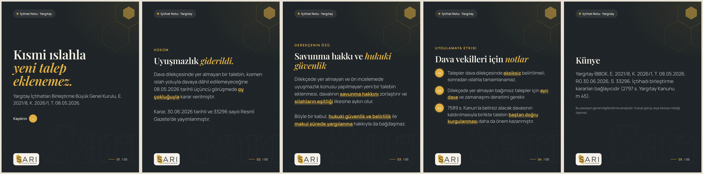

# Onay paketi: 16 Kasım Pazartesi – 22 Kasım Pazar

Onaylamak için sohbete gönderilerin tarihlerini yazmanız yeterli, örneğin **"16, 17 ve 18 Kasım'ı onaylıyorum"**. Düzeltme isterseniz tarihi ve değişikliği yazın. Onaylanan gönderiler planlanan gün sabah 09:50'de yayınlanır.

| # | Tarih | Seri | Format | Önizleme |
|---|---|---|---|---|
| 1 | 16 Kasım Pazartesi 10:00 | Haftanın Gündemi · Haklarınız | Kaydırmalı | [önizleme](onay/01_2026-11-16_haklariniz-indirim-iade.jpg) |
| 2 | 17 Kasım Salı 10:00 | Bu Senin Hakkın | Reels | [önizleme](onay/02_2026-11-17_repost-akran-zorbaligi.jpg) |
| 3 | 18 Kasım Çarşamba 10:00 | Hollanda'daki Türkler | Kaydırmalı | [önizleme](onay/03_2026-11-18_hollanda-bosanma-tescil.jpg) |
| 4 | 19 Kasım Perşembe 10:00 | İçtihat Notu | Kaydırmalı | [önizleme](onay/04_2026-11-19_ictihat-kismi-islah.jpg) |
| 5 | 20 Kasım Cuma 10:00 | Özel Günler | Reels | [önizleme](onay/05_2026-11-20_cocuk-haklari.jpg) |


## 1. 16 Kasım Pazartesi · Haftanın Gündemi · Haklarınız · Kaydırmalı


**Açıklama metni:**

```
İnternetten aldığınız ürünü, indirimde alsanız bile 14 gün içinde gerekçe göstermeden iade edebilirsiniz. 🛍️

💸 Paranız 14 gün içinde iade edilmelidir.
🏷️ İndirimden önceki fiyat, son 30 günün en düşük fiyatı olmalıdır.
🔧 Ürün bozuksa onarım, değişim, bedelde indirim veya iade isteyebilirsiniz.

Alışverişe çıkmadan önce kaydedin.

Kaynak: 6502 sayılı TKHK m.11 ve m.48, Mesafeli Sözleşmeler Yönetmeliği, Fiyat Etiketi Yönetmeliği.
Bu paylaşım genel bilgilendirme amaçlıdır; hukuki görüş veya tavsiye niteliği taşımaz.

#tüketicihakları #caymahakkı #indirim #iade
```

**Not:** 15.11.2026 revizyonu: kısa ve vurucu dil, 3–4 slayt.

**Kontrol edilecekler:**

- [ ] 30 gün kuralı raf ve fiyat etiketleri için geçerli; reklamlarda Bakanlık kılavuzuyla farklı (10 günlük) bir pencere uygulanıyor olabilir. Gönderi etiket fiyatı üzerinden anlatıyor.
- [ ] Cayma hakkı istisnaları (Mesafeli Sözleşmeler Yön. m.15) açıklamada genel olarak sayıldı.

**Durum:** ✅ Onaylandı

---

## 2. 17 Kasım Salı · Bu Senin Hakkın · Reels


**Açıklama metni:**

```
Çocuğunuz okulda akran zorbalığına maruz kalıyorsa sessiz kalmak zorunda değilsiniz.

🎥 Videonun tamamı @buseninhakkin hesabında.

Bu paylaşım genel bilgilendirme amaçlıdır; hukuki görüş veya tavsiye niteliği taşımaz.

#BuSeninHakkın #SarıAvukatlıkOrtaklığı
```

**Kaynak gönderi:** https://www.instagram.com/reel/DfhIYbfIqPG/

**Kontrol edilecekler:**

- [ ] Kanca metni videonun içeriğiyle örtüşüyor mu?

**Durum:** ✅ Onaylandı

---

## 3. 18 Kasım Çarşamba · Hollanda'daki Türkler · Kaydırmalı


**Açıklama metni:**

```
Hollanda'da boşandınız, ancak Türkiye'de hâlâ evli görünüyor olabilirsiniz. 🇳🇱🇹🇷

Boşanma kararı, Türkiye'deki nüfus kaydına kendiliğinden işlenmez. Bunun için iki yol vardır:
1️⃣ Konsolosluğa başvuru: Dava açmadan, eşlerin birlikte başvurusuyla tescil yapılır. Eski eşiniz yabancıysa tek başınıza başvurabilirsiniz.
2️⃣ Tanıma davası: Birlikte başvuru mümkün değilse, Türkiye'de aile mahkemesinde dava açılır.

Bu bilgiye ihtiyacı olabilecek biriyle paylaşın.

🇳🇱 Een in Nederland uitgesproken echtscheiding wordt niet automatisch in het Turkse bevolkingsregister verwerkt. Registratie kan zonder rechtszaak via het Turkse consulaat. Lukt dat niet, dan volgt een erkenningsprocedure bij de Turkse familierechtbank.

Kaynak: 5490 sayılı Nüfus Hizmetleri Kanunu m.27/A ve 5718 sayılı MÖHUK m.58.
Bu paylaşım genel bilgilendirme amaçlıdır; hukuki görüş veya tavsiye niteliği taşımaz. Hollanda tarafındaki işlemler için yerel bir uzmana danışın.

#HollandadakiTürkler #boşanma #konsolosluk #nüfus
```

**Not:** 15.11.2026 revizyonu: kısa ve vurucu dil, 3–4 slayt.

**Kontrol edilecekler:**

- [ ] m.27/A başvurusunda konsoloslukların istediği belge listesi (apostil ve tercüme şekli) Lahey Büyükelçiliği uygulamasıyla teyit edilmeli.
- [ ] Felemenkçe özet bir Felemenkçe bilen tarafından okunmalı.

**Durum:** ✅ Onaylandı

---

## 4. 19 Kasım Perşembe · İçtihat Notu · Kaydırmalı



**Açıklama metni:**

```
İçtihat Notu | Kısmi ıslahla, dava dilekçesinde yer almayan yeni bir talep eklenemez.

Yargıtay İçtihatları Birleştirme Büyük Genel Kurulu kararıdır.

Künye: E. 2021/8, K. 2026/1, T. 08.05.2026 (RG 30.06.2026, S. 33296).

Yüksek Mahkeme, daireler arasındaki görüş ayrılığını oy çokluğuyla gidermiştir. Gerekçede, kısmi ıslahın mevcut talep üzerinde düzeltme imkânı tanıdığı; dilekçede hiç bulunmayan bir istemin bu yolla eklenmesinin ıslahı fiilen ikinci bir dava açma aracına dönüştüreceği vurgulanmaktadır.

Uygulama açısından:
▪️ Talepler dava dilekçesinde eksiksiz belirtilmelidir.
▪️ Dilekçede yer almayan bağımsız talepler için ayrı dava ve zamanaşımı denetimi gerekir.
▪️ 7589 s. Kanun ile belirsiz alacak davasının kaldırılmasıyla birlikte talebin baştan doğru kurgulanması daha da önem kazanmıştır.

Bu paylaşım genel bilgilendirme amaçlıdır; hukuki görüş veya tavsiye niteliği taşımaz.

#Yargıtay #içtihadıbirleştirme #ıslah #HMK #medeniusulhukuku
```

**Kontrol edilecekler:**

- [ ] Gerekçe özeti ikincil kaynaklara dayanıyor; karar metniyle karşılaştırılmalı.
- [ ] Bağlayıcılık için 2797 s. Kanun m.45 atfının fıkrası teyit edilmeli.

**Durum:** ✅ Onaylandı

---

## 5. 20 Kasım Cuma · Özel Günler · Reels


**Açıklama metni:**

```
20 Kasım, Dünya Çocuk Hakları Günü. 🧒

18 yaşın altındaki herkes çocuktur ve dört temel ilkeyle korunur: ayrımcılık yasağı, çocuğun üstün yararı, yaşama ve gelişme hakkı ile görüşlerine saygı.

Her çocuk, hakların öznesidir.

Kaynak: BM Çocuk Haklarına Dair Sözleşme.
#DünyaÇocukHaklarıGünü #20Kasım #çocukhakları
```

**Not:** 15.11.2026 revizyonu: kısa ve vurucu dil, 3–4 slayt.

**Kontrol edilecekler:**

- [ ] Türkiye'de yürürlük yılı (1995) Resmî Gazete kaydından teyit edilmeli.

**Durum:** ✅ Onaylandı

---
