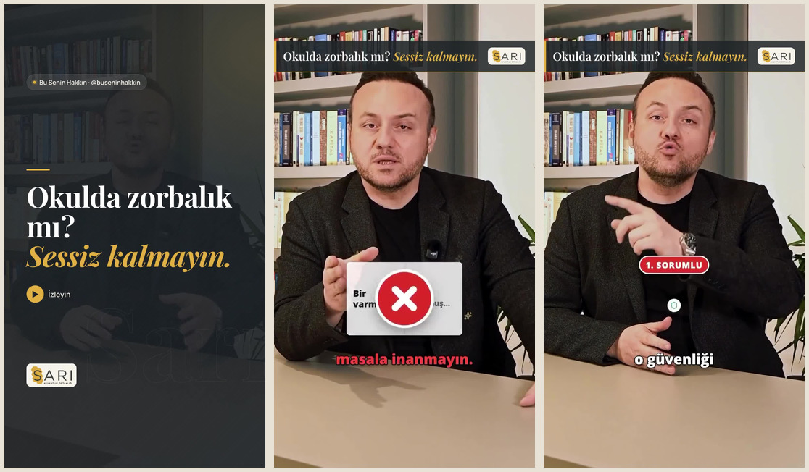
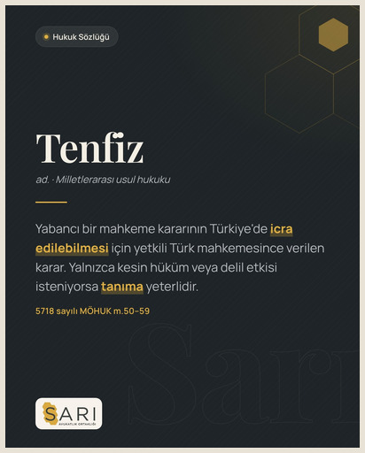
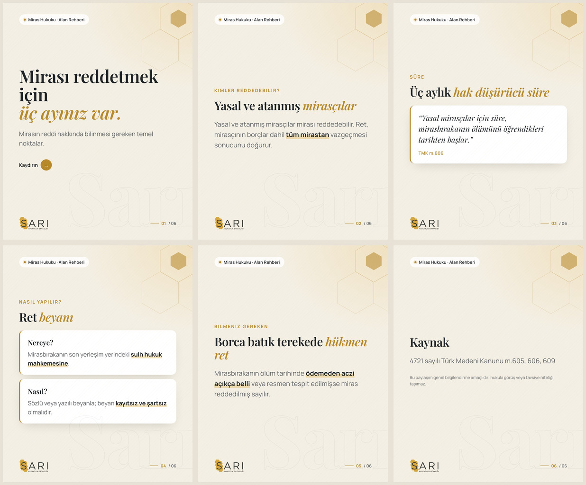
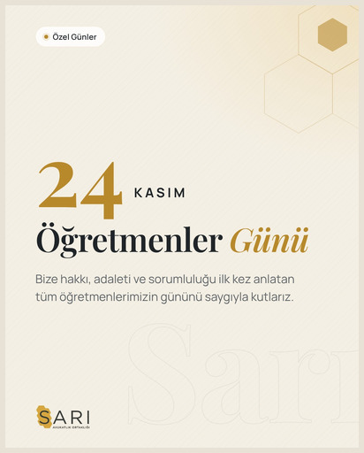
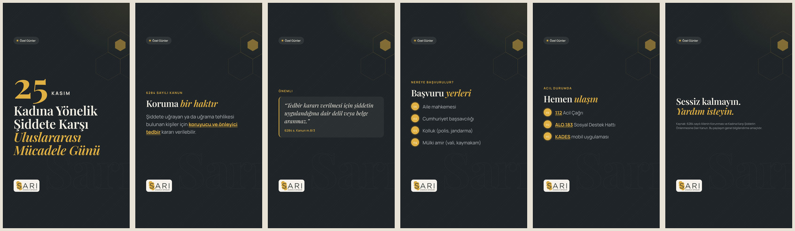
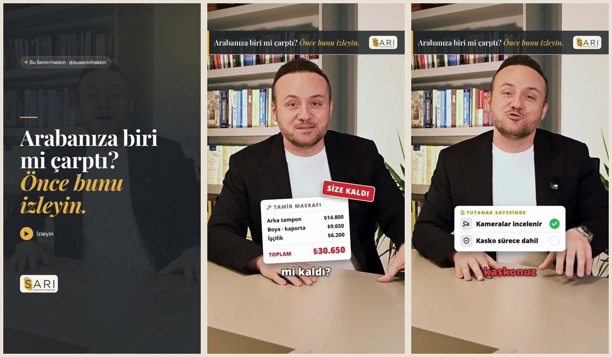

# Onay paketi: 16–27 Kasım 2026

Her gönderi için önizleme, açıklama metni ve kontrol edilecek noktalar aşağıda. Onaylamak için sohbete şöyle yazmanız yeterli: **"16, 17 ve 24 Kasım'ı onaylıyorum"**. Düzeltme isterseniz gönderinin tarihini ve değişikliği yazın.

| # | Tarih | Seri | Format | Önizleme |
|---|---|---|---|---|
| 1 | 16 Kasım Pazartesi | Hukuk Gündemi | Kaydırmalı | [onay/01_2026-11-16_belirsiz-alacak.jpg](onay/01_2026-11-16_belirsiz-alacak.jpg) |
| 2 | 17 Kasım Salı | Bu Senin Hakkın | Reels | [onay/02_2026-11-17_repost-akran-zorbaligi.jpg](onay/02_2026-11-17_repost-akran-zorbaligi.jpg) |
| 3 | 18 Kasım Çarşamba | Hukuk Sözlüğü | Tek görsel | [onay/03_2026-11-18_sozluk-tenfiz.jpg](onay/03_2026-11-18_sozluk-tenfiz.jpg) |
| 4 | 19 Kasım Perşembe | Alan Rehberi | Kaydırmalı | [onay/04_2026-11-19_rehber-mirasin-reddi.jpg](onay/04_2026-11-19_rehber-mirasin-reddi.jpg) |
| 5 | 20 Kasım Cuma | Özel Günler | Reels | [onay/05_2026-11-20_cocuk-haklari.jpg](onay/05_2026-11-20_cocuk-haklari.jpg) |
| 6 | 24 Kasım Salı | Özel Günler | Tek görsel | [onay/06_2026-11-24_ogretmenler-gunu.jpg](onay/06_2026-11-24_ogretmenler-gunu.jpg) |
| 7 | 25 Kasım Çarşamba | Özel Günler | Reels | [onay/07_2026-11-25_kadina-siddet.jpg](onay/07_2026-11-25_kadina-siddet.jpg) |
| 8 | 27 Kasım Cuma | Bu Senin Hakkın | Reels | [onay/08_2026-11-27_repost-arac-hasari.jpg](onay/08_2026-11-27_repost-arac-hasari.jpg) |


## 1. 16 Kasım Pazartesi · Hukuk Gündemi · Kaydırmalı


**Açıklama metni:**

```
Belirsiz alacak davası artık yok. Peki alacağın miktarını baştan bilemeyenler ne yapacak? ⚖️

12. Yargı Paketi olarak bilinen 7589 sayılı Kanun ile HMK m.107 yürürlükten kaldırıldı. Yerine kısmi davada bir defaya mahsus talep artırımı imkânı getirildi.

📌 Değişiklik 31 Temmuz 2026'da yürürlüğe girdi.
📌 Bu tarihten önce açılan belirsiz alacak davaları eski hükme göre görülmeye devam ediyor.
📌 Talep artırımı yalnızca bir kez yapılabiliyor.

Ayrıntılar kaydırmalı görselde. Daha sonra dönüp bakmak için kaydedebilirsiniz.

Kaynak: 7589 s. Kanun, RG 31.07.2026, S. 33326
Bu paylaşım genel bilgilendirme amaçlıdır; hukuki görüş veya tavsiye niteliği taşımaz.

#hukuk #yargıpaketi #HMK #medeniusul #mevzuat
```

**Kontrol edilecekler:**

- [ ] HMK m.109'a eklenen fıkranın tam lafzı ve zamanaşımının 'dava tarihinde kesilmiş sayılması' ifadesi Resmî Gazete metninden teyit edilmeli.
- [ ] Geçiş hükmünün (geçici madde) numarası ve kapsamı teyit edilmeli.
- [ ] Bazı kaynaklar bazı maddelerin 31.10.2026'da yürürlüğe girdiğini yazıyor; HMK 107'ye ilişkin hükmün yürürlük tarihi Kanun'un yürürlük maddesinden kontrol edilmeli.

**Durum:** ⏳ Onay bekliyor

---

## 2. 17 Kasım Salı · Bu Senin Hakkın · Reels



**Açıklama metni:**

```
Çocuğunuz okulda akran zorbalığına maruz kalıyorsa sessiz kalmak zorunda değilsiniz.

🎥 Videonun tamamı ve daha fazlası için: @buseninhakkin

Bu paylaşım genel bilgilendirme amaçlıdır; hukuki görüş veya tavsiye niteliği taşımaz.

#BuSeninHakkın #SarıAvukatlıkOrtaklığı
```

**Kaynak video:** https://www.instagram.com/reel/DfhIYbfIqPG/  ·  **Kanca:** Okulda zorbalık mı? *Sessiz kalmayın.*

**Kontrol edilecekler:**

- [ ] Kanca metni videonun içeriğiyle örtüşüyor mu?
- [ ] Videoda telifli müzik varsa Instagram sesi kapatabilir; kontrol edin.

**Durum:** ⏳ Onay bekliyor

---

## 3. 18 Kasım Çarşamba · Hukuk Sözlüğü · Tek görsel



**Açıklama metni:**

```
Hukuk Sözlüğü: Tenfiz 📖

Yurt dışında verilen bir boşanma, alacak veya ticari karar Türkiye'de kendiliğinden geçerli olmaz.

▫️ Tanıma: Yabancı kararın kesin hüküm ya da delil etkisinden yararlanmak için yeterlidir. Örneğin yurt dışında boşanan birinin nüfus kaydının güncellenmesi.
▫️ Tenfiz: Kararın Türkiye'de icra yoluyla zorla uygulanabilmesi için gereklidir. Örneğin yabancı mahkemenin hükmettiği bir alacağın tahsili.

Her iki süreç de 5718 sayılı Milletlerarası Özel Hukuk ve Usul Hukuku Hakkında Kanun'da (m.50–59) düzenlenir.

Bu paylaşım genel bilgilendirme amaçlıdır; hukuki görüş veya tavsiye niteliği taşımaz.

#hukuksözlüğü #tenfiz #tanıma #MÖHUK #yurtdışıboşanma
```

**Kontrol edilecekler:**

- [ ] Madde aralığı (tenfiz m.50–57, tanıma m.58–59) ve tanıma örneğinin (nüfus kaydı) doğruluğu teyit edilmeli.

**Durum:** ⏳ Onay bekliyor

---

## 4. 19 Kasım Perşembe · Alan Rehberi · Kaydırmalı



**Açıklama metni:**

```
Mirası reddetmek mümkün; ama süre kısa. ⏳

Türk Medeni Kanunu'na göre yasal ve atanmış mirasçılar mirası reddedebilir. Ret, borçlar dahil tüm mirastan vazgeçmek anlamına gelir.

📌 Süre: 3 ay (TMK m.606)
📌 Yer: Mirasbırakanın son yerleşim yerindeki sulh hukuk mahkemesi
📌 Şekil: Sözlü veya yazılı, kayıtsız ve şartsız beyan
📌 Borca batık terekede miras reddedilmiş sayılabilir (hükmen ret)

🎥 "Miras kaldı ama borç çıktı" konusunun videolu anlatımı @buseninhakkin hesabında.

Daha sonra dönüp bakmak için kaydedebilirsiniz.

Kaynak: TMK m.605, 606, 609
Bu paylaşım genel bilgilendirme amaçlıdır; hukuki görüş veya tavsiye niteliği taşımaz.

#mirashukuku #mirasınreddi #TMK #aile #miras
```

**Kontrol edilecekler:**

- [ ] TMK m.606'daki sürenin başlangıcına ilişkin ifadeler (yasal mirasçılar / vasiyetname ile atanmış mirasçılar ayrımı) kanun metninden teyit edilmeli.

**Durum:** ⏳ Onay bekliyor

---

## 5. 20 Kasım Cuma · Özel Günler · Reels


**Açıklama metni:**

```
20 Kasım Dünya Çocuk Hakları Günü 🧒

BM Çocuk Haklarına Dair Sözleşme 20 Kasım 1989'da kabul edildi. Bugün dünyada en çok taraf olunan insan hakları sözleşmelerinden biri.

Sözleşmenin dört temel ilkesi:
1️⃣ Ayrımcılık yasağı
2️⃣ Çocuğun üstün yararı
3️⃣ Yaşama ve gelişme hakkı
4️⃣ Çocuğun görüşlerine saygı

Her çocuk, hakların öznesidir.

🎥 Okulda akran zorbalığı ve okulun sorumluluğu hakkındaki videomuz için: @buseninhakkin

Bu paylaşım genel bilgilendirme amaçlıdır.

#DünyaÇocukHaklarıGünü #20Kasım #çocukhakları #insanhakları
```

**Not:** Video sessiz bir ses kanalıyla üretildi. İsterseniz yayından sonra uygulamadan telifsiz müzik eklenebilir.

**Kontrol edilecekler:**

- [ ] Türkiye'de yürürlük yılı (1995) Resmî Gazete kaydından teyit edilmeli.

**Durum:** ⏳ Onay bekliyor

---

## 6. 24 Kasım Salı · Özel Günler · Tek görsel



**Açıklama metni:**

```
Hakkı, adaleti ve sorumluluğu bize ilk kez sınıfta anlattılar. 📚

Başta Başöğretmenimiz Mustafa Kemal Atatürk olmak üzere tüm öğretmenlerimizin 24 Kasım Öğretmenler Günü'nü saygıyla kutlarız.

#24KasımÖğretmenlerGünü #ÖğretmenlerGünü
```

**Kontrol edilecekler:**

- [ ] Genel kontrol

**Durum:** ⏳ Onay bekliyor

---

## 7. 25 Kasım Çarşamba · Özel Günler · Reels



**Açıklama metni:**

```
25 Kasım Kadına Yönelik Şiddete Karşı Uluslararası Mücadele Günü 🟣

6284 sayılı Kanun'a göre, şiddete uğrayan ya da uğrama tehlikesi bulunan kişiler için koruyucu ve önleyici tedbir kararı verilebilir. Tedbir kararı için şiddetin uygulandığına dair delil veya belge aranmaz.

📍 Başvuru: aile mahkemesi, Cumhuriyet başsavcılığı, polis/jandarma, vali/kaymakamlık
📞 Acil: 112 · ALO 183 · KADES uygulaması

Bu bilgiye ihtiyacı olabilecek biriyle paylaşın.

Bu paylaşım genel bilgilendirme amaçlıdır; hukuki görüş veya tavsiye niteliği taşımaz.

#25Kasım #KadınaŞiddeteHayır #6284 #KADES
```

**Kontrol edilecekler:**

- [ ] Acil hat numaralarının güncelliği (ALO 183, KADES) kontrol edilmeli.

**Durum:** ⏳ Onay bekliyor

---

## 8. 27 Kasım Cuma · Bu Senin Hakkın · Reels



**Açıklama metni:**

```
Aracınız zarar gördüğünde nasıl bir yol izlemeniz gerektiğini biliyor musunuz?🤔

🎥 Videonun tamamı ve daha fazlası için: @buseninhakkin

Bu paylaşım genel bilgilendirme amaçlıdır; hukuki görüş veya tavsiye niteliği taşımaz.

#BuSeninHakkın #SarıAvukatlıkOrtaklığı
```

**Kaynak video:** https://www.instagram.com/reel/DfUFQAWoFGC/  ·  **Kanca:** Arabanıza biri mi çarptı? *Önce bunu izleyin.*

**Kontrol edilecekler:**

- [ ] Kanca metni videonun içeriğiyle örtüşüyor mu?
- [ ] Videoda telifli müzik varsa Instagram sesi kapatabilir; kontrol edin.

**Durum:** ⏳ Onay bekliyor

---
